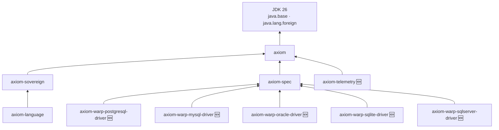
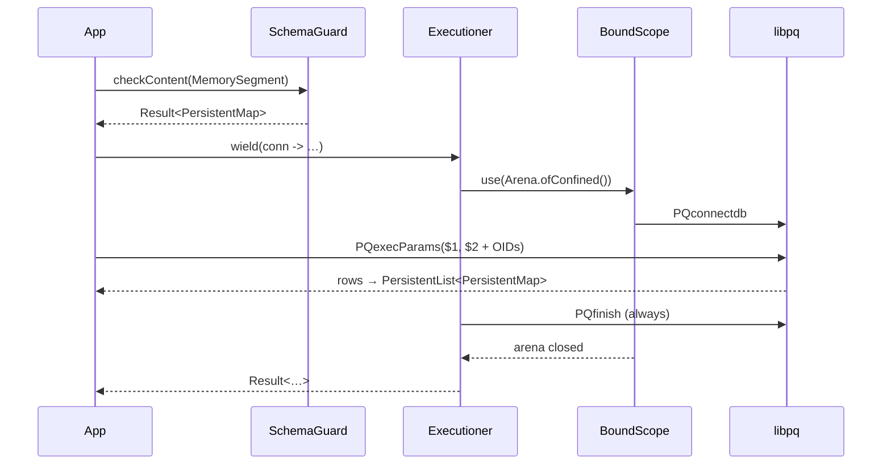

# Axiom 2.0.0 → 3.0.0 — Ultimate Release Changelog


> [!IMPORTANT]
> **This is a MAJOR release, and the largest one Axiom has shipped.**
> Two modules are retired (`axiom-warp-jdbc`, `axiom-warp-reactive`), five native database drivers and one telemetry module are introduced, and every parser entry point moves from `byte[]` to `java.lang.foreign.MemorySegment`.
> Code written against 2.x **will not compile** against 3.0.0 without migration.

> [!NOTE]
> **Scope and sources**
> - The **3.0.0** side of this document comes from the 3.0.0 production sources of all ten modules.
> - The **2.x** side comes from the published 2.0.0 documentation (the 2.x homepage, module READMEs and the [1.0.0 → 2.0.0 changelog](changelog-1.0.0-to-2.0.0.md)). If you maintain a fork of 2.x with local changes, diff it against your own tree as well.
> - Java baseline stays **26**. Everything is compiled with `--enable-preview`.

---

## Table of Contents

1. [Why 3.0.0 (SemVer justification)](#1-why-300-semver-justification)
2. [Published artifacts](#2-published-artifacts)
3. [BREAKING CHANGES (must read)](#3-breaking-changes-must-read)
4. [Executive summary: the three big themes](#4-executive-summary-the-three-big-themes)
5. [Who must upgrade: impact matrix](#5-who-must-upgrade-impact-matrix)
6. [Module-by-module details](#6-module-by-module-details)
7. [New dependency graph](#7-new-dependency-graph)
8. [Migration guide](#8-migration-guide)
9. [Runtime requirements](#9-runtime-requirements)
10. [Known notes and trade-offs](#10-known-notes-and-trade-offs)
11. [Migration checklist](#11-migration-checklist)
12. [Summary dashboard](#12-summary-dashboard)

---

## 1. Why 3.0.0 (SemVer justification)

The following public contracts are binary- and source-incompatible with 2.0.0:

- `axiom-warp-jdbc` and `axiom-warp-reactive` are **no longer published** for 3.x. `AxiomWarp`, `RawProvisioner.withPoolProvider`, `strike()`, `parallel(..)`, `ingest()`, `sync()`, `withHistory(..)` and the Vert.x client integration have no 3.x equivalents with the same signatures.
- `axiom-spec` **no longer contains database contracts**. `AxiomProtocol`, `AxiomRegistry`, `IngressBinder`, `RowMaterializer` and the shared `SqlParser` are gone; each driver now owns its own SQL parser and type catalog.
- All parser entry points (`AxiomDopParser.take`, `JsonParser.take`, `CsvRowParser.takeLine` / `scanLine`, `SchemaGuard.checkContent`) take a **`MemorySegment`** instead of `byte[]`.
- Database configuration keys change from a JDBC URL plus pool settings to native connection fields.

A minor release would violate SemVer, so all ten modules are published together as **3.0.0**.

---

## 2. Published artifacts

All artifacts share `groupId` `com.ensemblu` and version `3.0.0`, and each ships with a sources JAR and a Javadoc JAR, GPG-signed.

| Artifact ID | Status | Depends on | Role |
|---|---|---|---|
| `axiom` | Updated | JDK only | Foundation: `Result`, `If`, `Guard`, `PersistentList`, `PersistentMap`, `MapDelta`, `Source`, `ConfigSource`, `Dop`, `Effect` |
| `axiom-sovereign` | Updated | `axiom` | `AxiomDopParser`, the DOP (`.axiom`) grammar |
| `axiom-language` | Updated | `axiom-sovereign` | `SchemaGuard` + `MasterGuard` perimeter validation |
| `axiom-spec` | **Reshaped** | `axiom` | `JsonParser`, `JsonEmitter`, `CsvRowParser` only |
| `axiom-telemetry` | 🆕 **New** | `axiom` | `TemporalStreamBuffer`, `SovereignExecution` |
| `axiom-warp-postgresql-driver` | 🆕 **New** | `axiom-spec` | Native PostgreSQL via `libpq` |
| `axiom-warp-mysql-driver` | 🆕 **New** | `axiom-spec` | Native MySQL via `libmysqlclient` |
| `axiom-warp-oracle-driver` | 🆕 **New** | `axiom-spec` | Native Oracle via OCI (Instant Client) |
| `axiom-warp-sqlite-driver` | 🆕 **New** | `axiom-spec` | Native SQLite via `sqlite3` |
| `axiom-warp-sqlserver-driver` | 🆕 **New** | `axiom-spec` | Native SQL Server via ODBC |
| ~~`axiom-warp-jdbc`~~ | ⛔ **Retired** | — | Replaced by the native drivers |
| ~~`axiom-warp-reactive`~~ | ⛔ **Retired** | — | Concurrency → virtual threads; forensics → `axiom-telemetry` |

The 2.0.0 artifacts remain available on Maven Central; nothing is unpublished.

---

## 3. BREAKING CHANGES (must read)

| # | Area | 2.x | 3.0.0 | Action required |
|---|---|---|---|---|
| 1 | Database engine | `axiom-warp-jdbc` + your pool + vendor JDBC driver | `axiom-warp-<engine>-driver` + the vendor's native client library | Swap the dependency; remove the pool and JDBC driver |
| 2 | Reactive engine | `axiom-warp-reactive` (Vert.x 5) | — | Use virtual threads around `wield(..)` |
| 3 | Provisioning | `AxiomWarp.connect(cfg).withPoolProvider(..).validateRules()` | `PostgreSQL.connect(cfg).requiredHost()…getPostgreSqlDriverOrThrow()` (one curried chain per engine) | Rewrite boot code (see §8) |
| 4 | Config keys | `engine.url`, `engine.pool.min`, `engine.pool.max` | `engine.host`, `engine.port`, `engine.dbname` (Oracle: `engine.service_name`; SQLite: `engine.path`), `engine.user`, `engine.password` | Rewrite properties |
| 5 | Queries | `strike().dynamic(sql).withContract(map).withData(map)` | `dynamicQuery(sql).to(v).bind(Type).execute(conn)` | Bind each marker positionally with an explicit engine type |
| 6 | Read/write scopes | `warp.read(..)` / `warp.write(..)` | `wield(conn -> …)` / `transaction(conn, () -> …)` | Wrap work in `wield`; use `transaction` for atomic writes |
| 7 | Batched writes | `strike().bulk(..)` | Loop inside `transaction(..)`, or `fromFile(..)` for CSV | Rewrite |
| 8 | Parallel reads | `warp.parallel(List<StrikeInstruction>)` | One `wield` per virtual thread | Rewrite with `Executors.newVirtualThreadPerTaskExecutor()` |
| 9 | CSV ingest | `ingest().fromFile(p).usingFileHeaders().onTableName(t)` | `fromFile(p).withConnection(conn).usingFileHeaders().withDataTypes(..).onTableName(t)` | Declare one type per column |
| 10 | Delta sync | `warp.sync().whereDelete(..).whereUpdate(..).withDelta(d)` | — | Compute `MapDelta` yourself and issue explicit statements |
| 11 | Type contract | `AxiomProtocol` (closed enum + `OPAQUE` + `::cast`) | Engine catalogs: `PostgresType`, `MySqlType`, `OracleType`, `SqliteType`, `SqlServerType` | Replace contract maps with per-bind types |
| 12 | Parser input | `byte[]` | `MemorySegment` | Wrap with `MemorySegment.ofArray(bytes)` or memory-map files |
| 13 | `axiom-spec` DB contracts | `AxiomProtocol`, `AxiomRegistry`, `IngressBinder`, `RowMaterializer`, `SqlParser` | Removed from `axiom-spec` | Use the driver's own `engine` / `catalog` packages |
| 14 | Forensic history | `warp.withHistory(Duration)` / `withCache(TemporalStreamBuffer)` | `SovereignExecution.wieldWithTelemetry(buffer, lookback, action)` | Add `axiom-telemetry` |

> [!CAUTION]
> **Result values are text.** The native drivers return every column as the string the database client produced (for example `"50000.0000"` for a `NUMERIC`). Convert at the edge with `targetKey(..).toDoubleVal()` / `toBigDecimalResult()` and similar, and don't cast directly.

---

## 4. Executive summary: the three big themes

### Theme 1: Native drivers replace JDBC

Every database is reached through its vendor's own C client, using the Foreign Function & Memory API (final since Java 22). Nothing sits between your code and the client: no JDBC, no pool and no reflection.

```
2.x   your code → AxiomWarp → JDBC → HikariCP → vendor JDBC driver → wire
3.0   your code → Executioner → Panama downcall → libpq / OCI / ODBC / … → wire
```

Each `wield(..)` opens a dedicated native connection inside a confined `Arena` that is bound to the call through `ScopedValue` (`BoundScope`). The connection is closed and the arena freed before `wield` returns, whether the call succeeds or fails.

### Theme 2: Off-heap first

Parsers now read a `MemorySegment`, so a schema, config file or upload can be **memory-mapped from disk and parsed in place**. Parsed output is frozen into a shared arena and outlives the input segment.

### Theme 3: Smaller, sharper modules

- `axiom-spec` is now purely the wire contract: JSON in, JSON out, CSV rows.
- Database contracts live in the driver that implements them.
- The forensic flight recorder becomes `axiom-telemetry`. It's usable with **any** `Result`, not only database calls.

---

## 5. Who must upgrade: impact matrix

| You use… | Impact | What to do |
|---|---|---|
| Only `axiom` (collections, `Result`, `If`, `Source`, config) | 🟢 Low | Bump the version. Re-run tests. If you used `MapDelta.invert()` (documented on the 2.x homepage), note that 3.0's `MapDelta` exposes `added()`, `removed()`, `updated()` and `isEmpty()` |
| `axiom-sovereign` / `axiom-language` / `axiom-spec` parsers | 🟡 Medium | Replace `byte[]` arguments with `MemorySegment` |
| `axiom-spec` database contracts (`AxiomProtocol`, `SqlParser`, …) | 🔴 High | Move to a driver's `PostgresType`/… catalog and `dynamicQuery` |
| `axiom-warp-jdbc` | 🔴 High | Migrate to the native driver for your engine (§8) |
| `axiom-warp-reactive` | 🔴 High | Native driver + virtual threads; forensics via `axiom-telemetry` |

---

## 6. Module-by-module details

### 6.1 `axiom` (foundation)

- Still **zero dependencies**; only `java.*` is imported anywhere in the 3.0.0 tree.
- Collections: `PersistentList` (vector trie) and `PersistentMap` (HAMT) with `asTransient()` builders sealed by `freeze(Arena)`.
- Validation trio: `If` (fail-fast), `Axiom.Check.soft(..)` (collect every breach → `generateResultErrorIfExists()`), and `Guard` via `Axiom.Check.supplyThat(..)` (lazy conditions → `orFail(..).yield(..)`).
- `Dop.resolve` transparently unwraps JDK 26 `LazyConstant` values before casting; `Dop.normalize` remains the single canonicalisation point (whole doubles → `Integer` / `Long`, numeric and boolean strings → values).

### 6.2 `axiom-sovereign`

```java
// 2.x
AxiomDopParser.take(rawBytes).openBuffer().parse();
// 3.0
AxiomDopParser.take(MemorySegment.ofArray(rawBytes)).openBuffer().parse();
```

The single-pass cursor reads `ValueLayout.JAVA_BYTE` directly from the segment and only materialises the slices that become keys and values. Triple-quoted strings (`"""…"""`) are supported for multi-line values such as SQL.

### 6.3 `axiom-language`

- `SchemaGuard.checkContent(MemorySegment)` replaces `checkContent(byte[])`; `checkContent(PersistentMap)` is unchanged.
- `withParser(..)` now takes a `Function<MemorySegment, PersistentMap<String, Object>>`.
- Schemas are loaded from the classpath first, then the filesystem, memory-mapped into a shared `SCHEMA_ARENA`, and cached in `SchemaGuard.REGISTRY`. Use `reload(path)` / `reloadAll()` for hot reload.

### 6.4 `axiom-spec`: reshaped

| Kept (now `MemorySegment`-based) | Removed |
|---|---|
| `JsonParser.take(seg).openBuffer().ensureRootIsObject().parseObject()` / `ensureRootIsList()` | `AxiomProtocol`, `AxiomRegistry` |
| `CsvRowParser.takeLine(seg).basedOnHeaders(..)` / `scanLine(seg)` | `IngressBinder`, `RowMaterializer` |
| `JsonEmitter.emit(Object)` | Shared `SqlParser` (each driver has its own) |

### 6.5 🆕 `axiom-telemetry`

```java
var recorder = TemporalStreamBuffer.<Order>ofWindowDuration(Duration.ofMinutes(5));

Result<Order> r = SovereignExecution.wieldWithTelemetry(recorder, Duration.ofSeconds(30),
        () -> orders.place(cmd));
// failure message:
// 💥 AHE BREACH | PRE-FAILURE SNAPSHOT: [...]
// ---------------------------
// RAW BREACH EVIDENCE: <original message>
```

The buffer is lock-free (`AtomicReference` + immutable `PersistentList`) and evicts events older than its window on every write. See [A Black Box for Every Result](axiom-telemetry-flight-recorder.md).

### 6.6 🆕 The five native drivers

All five share one package layout (`api`, `provision`, `engine`, `ingest`, `io`, `scope`, `catalog`) and one `Executioner` surface:

| Method | Purpose |
|---|---|
| `wield(conn -> Result<T>)` | Open a native connection in a confined arena, run, always disconnect |
| `transaction(conn, () -> T)` | Atomic block; any throwable → rollback → failed `Result` |
| `wieldTransactional(() -> sql, …)` | Run several statements as one ACID batch (schema bootstrap) |
| `shot(sql).withConnection(conn)` | Raw statement |
| `dynamicQuery(sql)…execute(conn)` | `:java.name` markers bound positionally (max 21) |
| `fromFile(csv).withConnection(conn).usingFileHeaders().withDataTypes(..).onTableName(t)` | Contract-verified bulk ingest |

| Engine | Native client | Bind mechanism | Bulk mechanism | Transactions |
|---|---|---|---|---|
| PostgreSQL | `libpq` | `$n` via `PQexecParams` + explicit OID | `COPY … FROM STDIN WITH CSV` | `BEGIN`/`COMMIT`/`ROLLBACK` |
| MySQL | `libmysqlclient` | `?` → escaped literal (`bindQuotedValue`) / trusted literal (`bindValue`) | batched multi-row `INSERT` | `BEGIN`/`COMMIT`/`ROLLBACK` |
| Oracle | OCI | `:n` via `OCIBindByPos` | prepared `INSERT`, bind-once buffers | `OCITransCommit`/`OCITransRollback` |
| SQLite | `sqlite3` | `sqlite3_bind_*` | prepare once, `step`/`reset` per row | `BEGIN`/`COMMIT`/`ROLLBACK` |
| SQL Server | ODBC + MS ODBC Driver 18 | `?` via `SQLBindParameter` | prepared `INSERT`, bind-once buffers | `BEGIN TRANSACTION`/`COMMIT` |

Deep dive: [Why Axiom 3 Talks to Databases Natively](axiom-3-native-drivers.md).

### 6.7 Reference strike

The flagship demo (`axiom-strike-jdbc` repository) is rewritten for 3.0 as **`axiom-strike-postgresql`**. It has the same three endpoints (`/strike/accounts/query`, `/strike/accounts/bulk-txn`, `/strike/system/parallel-metrics`) and seed data, and it now has **zero** third-party dependencies (HikariCP, slf4j-simple and the PostgreSQL JDBC driver are gone). Run it with `mvn compile exec:exec`.

---

## 7. New dependency graph





---

## 8. Migration guide

### Step 1: Dependencies

```xml
<!-- remove -->
<artifactId>axiom-warp-jdbc</artifactId>       <!-- or axiom-warp-reactive -->
<artifactId>HikariCP</artifactId>
<artifactId>postgresql</artifactId>            <!-- vendor JDBC driver -->

<!-- add -->
<dependency>
    <groupId>com.ensemblu</groupId>
    <artifactId>axiom-warp-postgresql-driver</artifactId>
    <version>3.0.0</version>
</dependency>
```

Bump every other `com.ensemblu` artifact to `3.0.0`.

### Step 2: Install the native client

| Engine | Install | Windows lookup name |
|---|---|---|
| PostgreSQL | PostgreSQL client or server (`libpq`) | `libpq.dll` on `PATH` |
| MySQL | MySQL client libraries | `libmysql.dll` on `PATH` |
| Oracle | Oracle Instant Client | `%ORACLE_HOME%\bin\oci.dll`, or `oci.dll` on `PATH` |
| SQLite | sqlite.org precompiled DLL | `sqlite3.dll` on `PATH` |
| SQL Server | Microsoft ODBC Driver 18 | `odbc32.dll` (built in) |

### Step 3: Configuration

```properties
# 2.x
engine.url=jdbc:postgresql://localhost:5432/axiom_demo
engine.user=axiom_commander
engine.password=strike_hard
engine.pool.min=4
engine.pool.max=12

# 3.0
engine.host=localhost
engine.port=5432
engine.dbname=axiom_demo
engine.user=axiom_commander
engine.password=strike_hard
```

### Step 4: Provisioning

```java
// 2.x
AxiomWarp warp = AxiomWarp.connect(config)
        .withPoolProvider(map -> AxiomDataSourceAdapter.of(new HikariDataSource(hikariConfig)))
        .validateRules()
        .map(AxiomWarp::new)
        .getOrThrow();

// 3.0
PostgreSQL.Executioner pg = PostgreSQL
        .connect(Axiom.Config.file("database.properties"))
        .requiredHost()
        .requiredPort()
        .requiredDbName()
        .requiredUser()
        .optionalPassword()
        .getPostgreSqlDriverOrThrow();
```

### Step 5: Reads

```java
// 2.x
warp.read(() -> warp.strike()
        .dynamic("SELECT * FROM accounts WHERE status = :java.status LIMIT :java.limit")
        .withContract(contract)
        .withData(data)
        .getOrThrow());

// 3.0
pg.wield(conn -> pg
        .dynamicQuery("SELECT * FROM accounts WHERE status = :java.status LIMIT :java.limit")
        .to(status).bind(PostgresType.TEXT)
        .to(limit).bind(PostgresType.INT8)
        .execute(conn));
```

Bind **every** marker, **in order of appearance**. A name that appears twice is two markers.

### Step 6: Batched writes

```java
// 3.0: all-or-nothing on one session
pg.wield(conn -> pg.transaction(conn, () ->
        batch.fold(0, (n, tx) -> {
            pg.dynamicQuery("INSERT INTO ledger (account_id, amount) VALUES (:java.a, :java.m)")
              .to(tx.targetKey("account_id").toStringVal()).bind(PostgresType.UUID)
              .to(tx.targetKey("amount").toObjectVal()).bind(PostgresType.NUMERIC)
              .execute(conn).getOrThrow();
            return n + 1;
        })));
```

Inline casts such as `:java.account_id::uuid` are no longer needed, because the bind carries the type OID.

### Step 7: Parallel reads

```java
try (var lanes = Executors.newVirtualThreadPerTaskExecutor()) {
    var a = lanes.submit(() -> pg.wield(conn -> countQuery(conn)));
    var b = lanes.submit(() -> pg.wield(conn -> sumQuery(conn)));
    var x = a.get();
    var y = b.get();
    return x.flatMap(r1 -> y.map(r2 -> merge(r1, r2)));
}
```

### Step 8: CSV ingest

```java
pg.wield(conn -> pg.fromFile("csv/initial_accounts.csv")
        .withConnection(conn)
        .usingFileHeaders()
        .withDataTypes(PostgresType.VARCHAR, PostgresType.NUMERIC,
                       PostgresType.VARCHAR, PostgresType.VARCHAR)
        .onTableName("accounts"));
```

Before any row moves, the declared header/type pairs are checked against the live catalog. Every mismatch is reported in one failure, for example:

```
Contract Breach: declared mapping does not match table accounts:
  - column 'balance' declared VARCHAR (oid 1043) but the table has numeric(18,4) (oid 1700)
```

### Step 9: Parsers

```java
var seg = MemorySegment.ofArray(bytes);                 // or FileChannel.map(..)
JsonParser.take(seg).openBuffer().ensureRootIsObject().parseObject();
CsvRowParser.takeLine(seg).basedOnHeaders("a", "b");
SchemaGuard.checkContent(seg).basedOnSchemaInPath("schemas/x").withAxiomParser();
```

### Step 10: Forensics (reactive users)

```java
// 2.x
warp.withHistory(Duration.ofSeconds(30)).read(client -> …);

// 3.0
SovereignExecution.wieldWithTelemetry(recorder, Duration.ofSeconds(30), () -> pg.wield(conn -> …));
```

---

## 9. Runtime requirements

| Requirement | Value |
|---|---|
| JDK | 26 |
| JVM flags | `--enable-preview` (required), `--enable-native-access=ALL-UNNAMED` (recommended) |
| Executable JARs | Add `Enable-Native-Access: ALL-UNNAMED` to the manifest |
| Native client | Must be resolvable by the OS loader (see Step 2) |

---

## 10. Known notes and trade-offs

> [!WARNING]
> **Native library names outside Windows.** Drivers resolve their client by name, for example `System.mapLibraryName("libpq")` for PostgreSQL and `"mysqlclient"`, `"libsqlite3"`, `"odbc"` and `"clntsh"` elsewhere. These names are tuned for Windows. On Linux and macOS, verify that the loader can resolve them (an exact soname, a symlink, or `java.library.path`) before relying on them in CI.

> [!NOTE]
> **No connection pool, by design.** Each `wield` costs one connection handshake. Group related statements inside a single `wield`, and measure against your latency budget for high-rate endpoints.

> [!NOTE]
> **MySQL binding.** The MySQL C API has no out-of-band text-protocol parameters, so values are escaped through `mysql_real_escape_string` and spliced. `bindQuotedValue` is the safe default for user input. Use `bindValue` only for trusted numeric literals.

> [!TIP]
> **Leftover pool keys.** `engine.pool.min` / `engine.pool.max` in a 3.0 config are ignored. Remove them to avoid confusion.

---

## 11. Migration checklist

- [ ] Every `com.ensemblu` dependency is at `3.0.0`
- [ ] `axiom-warp-jdbc` / `axiom-warp-reactive` removed; the right `axiom-warp-<engine>-driver` added
- [ ] HikariCP, the vendor JDBC driver and Vert.x removed (unless used elsewhere)
- [ ] Native client installed and resolvable on every target machine
- [ ] Properties rewritten to `engine.host` / `port` / `dbname` (or `service_name` / `path`) / `user` / `password`
- [ ] Boot code uses the driver's curried `connect(..)` chain
- [ ] All `strike().dynamic(..)` calls rewritten to `dynamicQuery(..).to(..).bind(..)`
- [ ] All `AxiomProtocol` contracts replaced by engine type catalogs
- [ ] Batch writes moved inside `transaction(..)`
- [ ] `warp.parallel(..)` replaced with virtual threads
- [ ] CSV ingest declares `withDataTypes(..)` matching the table exactly
- [ ] All `byte[]` parser arguments wrapped as `MemorySegment`
- [ ] Result values converted at the edge (they're text)
- [ ] Application started with `--enable-preview` (+ `--enable-native-access=ALL-UNNAMED`)
- [ ] Smoke-tested: schema validation, parameterised read, transactional write + rollback, CSV ingest

---

## 12. Summary dashboard

| Module | Status | Breaking? | Theme |
|---|---|---|---|
| `axiom` | Updated | Low | Zero-dependency foundation, Arena-aware builders |
| `axiom-sovereign` | Updated | **Yes** | `byte[]` → `MemorySegment` |
| `axiom-language` | Updated | **Yes** | `SchemaGuard` on `MemorySegment` |
| `axiom-spec` | Reshaped | **Yes** | Wire contract only; DB contracts moved to drivers |
| `axiom-telemetry` | 🆕 New | — | Black-box flight recorder for any `Result` |
| `axiom-warp-postgresql-driver` | 🆕 New | — | `libpq`, `PQexecParams`, `COPY` |
| `axiom-warp-mysql-driver` | 🆕 New | — | `libmysqlclient`, escaped splice, multi-row `INSERT` |
| `axiom-warp-oracle-driver` | 🆕 New | — | OCI, `OCIBindByPos`, bind-once ingest |
| `axiom-warp-sqlite-driver` | 🆕 New | — | `sqlite3`, prepare-once ingest |
| `axiom-warp-sqlserver-driver` | 🆕 New | — | ODBC, `SQLBindParameter` |
| `axiom-warp-jdbc` | ⛔ Retired | **Yes** | → native drivers |
| `axiom-warp-reactive` | ⛔ Retired | **Yes** | → virtual threads + `axiom-telemetry` |

---

**Bottom line**

3.0.0 finishes what 2.0.0 started. 2.0 removed intermediate `String`s from the parsing pipeline; 3.0 removes intermediate *layers* from the whole stack. Bytes are parsed off-heap, validated at the perimeter and bound out-of-band straight into the vendor's own client, and the runtime dependency tree is just the JDK.

---

## Related

- [Why Axiom 3 Talks to Databases Natively](axiom-3-native-drivers.md)
- [A Black Box for Every Result: axiom-telemetry](axiom-telemetry-flight-recorder.md)
- [Axiom 1.0.0 → 2.0.0 changelog](changelog-1.0.0-to-2.0.0.md)
- [Project Axiom homepage](https://ensemblu-corp.github.io/assets/index.html)
